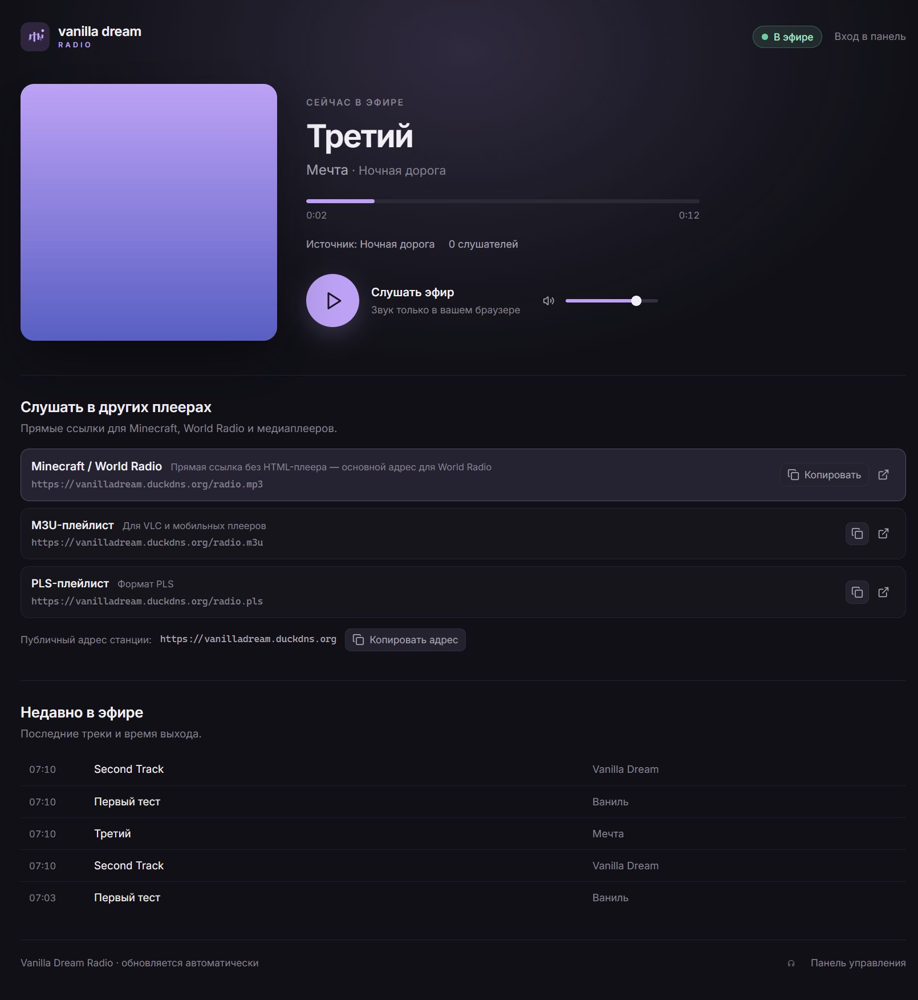
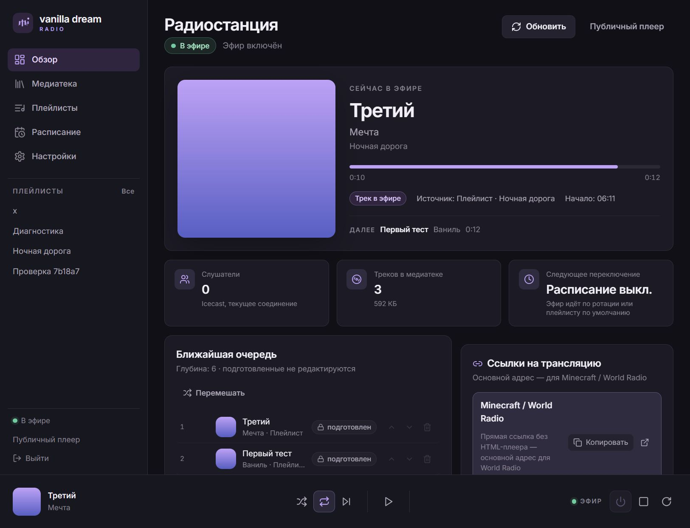
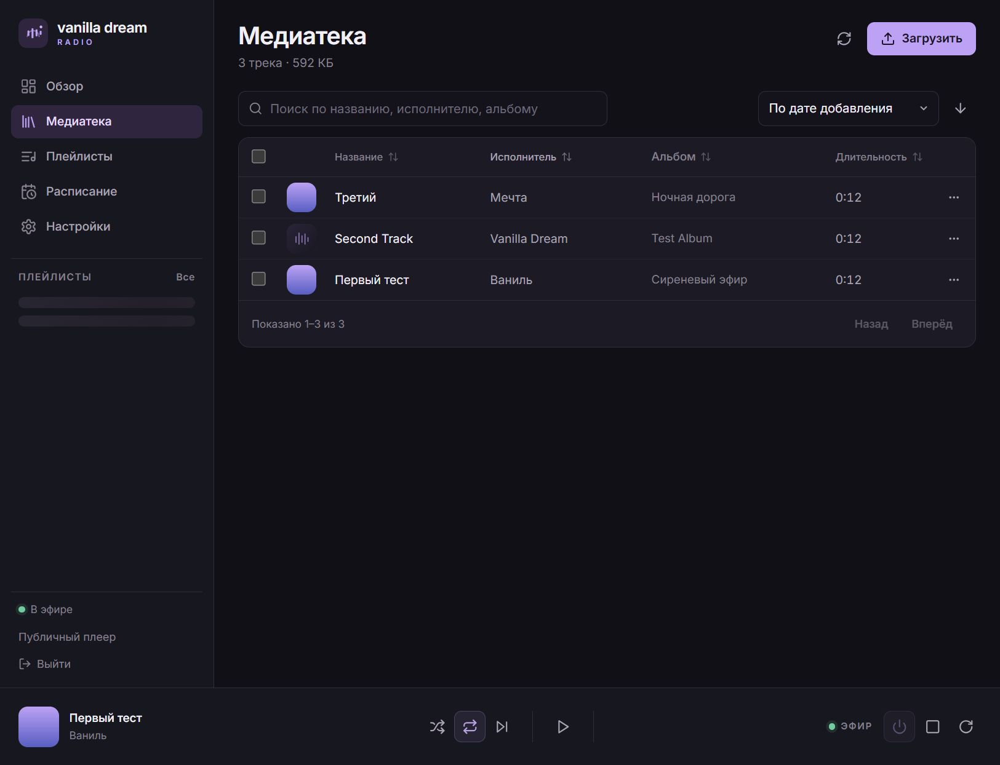
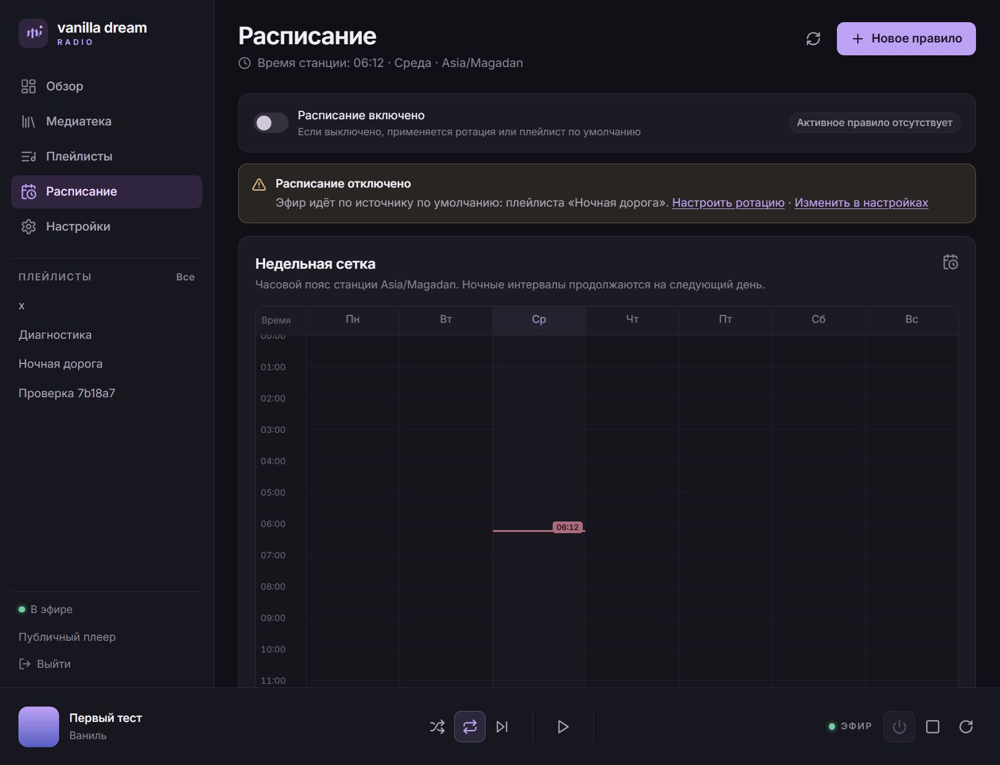

# Vanilla Dream Radio

Self-hosted internet radio for a small community: a continuous MP3 stream, a
public web player and a browser control panel. Built to replace a paid radio
hosting account with something one person can run on a single VPS. Current version: **1.3.0** (see `CHANGELOG.md`).

- **Liquidsoap** decodes and encodes the stream, **Icecast** distributes it.
- **FastAPI + SQLite** owns the library, playlists, rotation, schedule, queue
  and station state. One process, no broker, no second database.
- **React + Vite** (static build) provides the public player and the admin panel.
- Everything is served from one domain through Caddy with automatic HTTPS.

## Features

- Library with drag-and-drop batch upload, progress per file, Mutagen tags and
  embedded cover extraction, Cyrillic/Unicode safe.
- Duplicate-safe import: identical files and matching tags are never silently
  rejected or overwritten; the owner reviews matches in one dialog and decides
  per file or in bulk, keeping independent copies when needed.
- Per-track editor for title, artist, album and a custom cover (with return to
  the original), applied without touching the source file.
- Download a single track (with current tags or as the original file), a
  selection, a playlist or the whole library as a ZIP with `playlist.m3u8`.
- **«Вся медиатека»** — a system playlist that always contains every available
  track; new uploads join it automatically, deleted files leave it, and it plays
  with shuffle and repeat out of the box, so the station works without any
  manual playlist setup.
- Playlists with ordering, shuffle cycles, repeat modes and their own covers
  (uploaded or derived from the tracks).
- Rotation across playlists (sequential, by track count, random).
- Weekly schedule in a configurable IANA timezone with overnight rules,
  priorities and transition modes.
- Queue that reflects what the engine will actually play, with manual
  "play now" / "play next" interventions that do not disable the schedule.
- Station control (start, stop, restart, skip) as real systemd operations, with
  desired state, actual unit state and stream availability kept separate.
- Public player, M3U/PLS playlists, direct MP3 endpoint (also over plain HTTP for
  Minecraft's World Radio mod), now-playing metadata and listener counts from
  Icecast statistics.

## Requirements

Ubuntu 24.04 (or similar), Icecast 2.4, Liquidsoap 2.2, Python 3.12, Caddy for
TLS termination, ffmpeg for media probing. No Docker, no Redis, no external
services.

## Install

```bash
sudo bash deploy/install.sh --sha <git-commit> --admin-password-file /root/vdr-password
```

The script is idempotent: it creates the `vdradio` user, directories, virtual
environment, secrets, systemd units, sudoers allow-list, log rotation and the
Caddy site, initialises the database and leaves the station stopped until you
start it from the panel.

## Update

```bash
pwsh deploy/deploy.ps1        # builds the frontend, pushes main, updates the server
```

The server keeps three releases under `/opt/vanilla-dream-radio/releases` and
rolls back the symlink if the API does not become healthy.

## Configuration

Runtime configuration is environment based (`VD_*`, see `.env.example`) and is
written to `/etc/vanilla-dream-radio/env` on the server. Station name,
description, genre and bitrate are editable in the panel; a bitrate change
restarts the engine.

## Layout on the server

| Path | Contents |
| --- | --- |
| `/opt/vanilla-dream-radio/current` | checked-out release (code) |
| `/opt/vanilla-dream-radio/venv` | Python environment |
| `/opt/vanilla-dream-radio/frontend-dist` | static frontend build |
| `/srv/vanilla-dream-radio/music` | audio files |
| `/srv/vanilla-dream-radio/covers` | extracted covers |
| `/var/lib/vanilla-dream-radio` | SQLite database and state |
| `/etc/vanilla-dream-radio` | configuration and secrets |
| `/var/backups/vanilla-dream-radio` | daily compact database backups |

## Screenshots

| Public player | Admin overview |
| --- | --- |
|  |  |

| Library | Schedule |
| --- | --- |
|  |  |

## Tests

```bash
cd backend && .venv/Scripts/python -m pytest -q    # backend behaviour
python tests/e2e/check_stream.py                   # real stream decodes (server)
```

## Licence

No licence is granted for this source. All rights reserved by the author.
